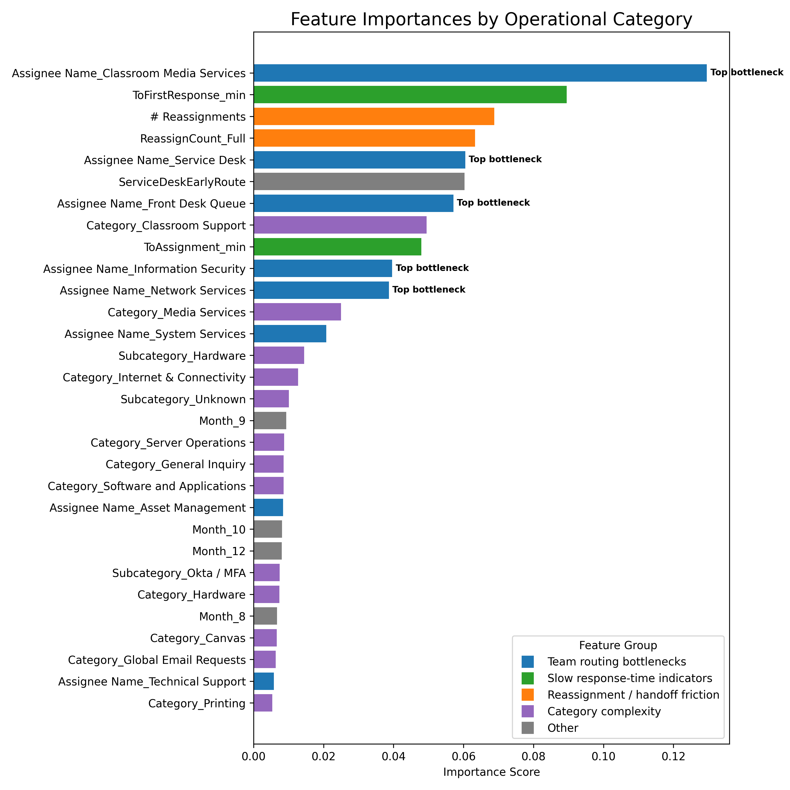
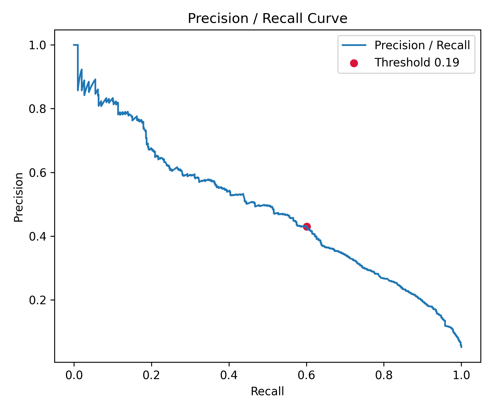

# Catalyst

Flagging IT support tickets that are headed for an SLA breach, early enough to do something about it.

Built for the University of Tampa ITS service desk, January to May 2025.

## The problem

UTampa ITS closed 11,561 tickets in 2023. About 5% of them (597) stayed open more than 14 days. Those are the tickets that matter, and they disappear when you look at averages across everything.

So the question was narrow: using only what's known early in a ticket's life, can we tell which ones are going to breach?

## What I did

- **Redefined "delayed."** A ticket counts as a breach if it closed more than 14 days after it was created. That isolates the ~5% worth acting on instead of modeling every slow ticket.
- **Used early signals only.** Time to assignment, time to first response, weekend creation, whether the service desk routed it early, which team queue it landed in, and how many times it changed teams.
- **Removed leakage.** Anything that reveals the outcome (resolution and closure times) is dropped before training.
- **Trained for the rare class.** Random Forest with class weighting and stratified 5-fold cross-validation, then probability calibration.
- **Picked the threshold on purpose.** Missing a breach costs more than a false alarm, so the threshold maximizes precision while keeping breach recall at 0.6 or higher.
- **Explained it.** Feature importance and SHAP to see what actually drives breaches.

## Results (real 2023 data)

- Catches **60%+ of the tickets that went on to breach** on a held-out 20% test set
- Macro recall 0.76, accuracy 0.90 on that test set
- **Top drivers:** which team queue a ticket lands in, slow first response, and reassignments between teams





## About the data

The real ticket data belongs to UTampa ITS and is not in this repo. `data/raw/tickets.csv` here is **synthetic**: made-up tickets in the same format, generated by `scripts/make_sample_data.py`, so the pipeline runs end to end. Results from the synthetic file will not match the numbers above.

## Run it

```bash
pip install -r requirements.txt
python3 scripts/make_sample_data.py   # writes data/raw/tickets.csv (synthetic)
python3 src/preprocess.py             # writes data/processed/tickets_cleaned.csv
python3 src/model.py                  # trains, calibrates, saves to models/
cd src && python3 evaluate.py         # writes reports/ and reports/figures/
```

## Layout

```
src/preprocess.py         early-life features, leakage removal, label
src/model.py              Random Forest, cross-validation, calibration, threshold
src/evaluate.py           confusion matrix, PR curve, feature importance, SHAP
scripts/make_sample_data.py   synthetic ticket generator
docs/                     figures from the real-data run
```

Tested with scikit-learn 1.7. Version 1.8 removed the `cv="prefit"` option that `model.py` uses for calibration, so `requirements.txt` pins below it.

## Stack

Python, pandas, scikit-learn, SHAP, matplotlib
